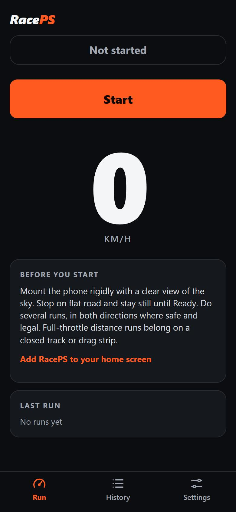
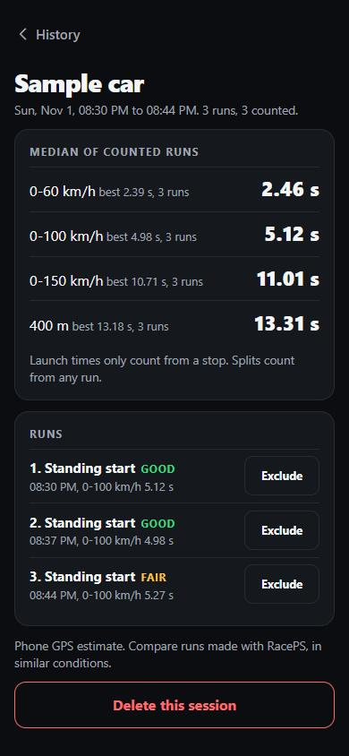
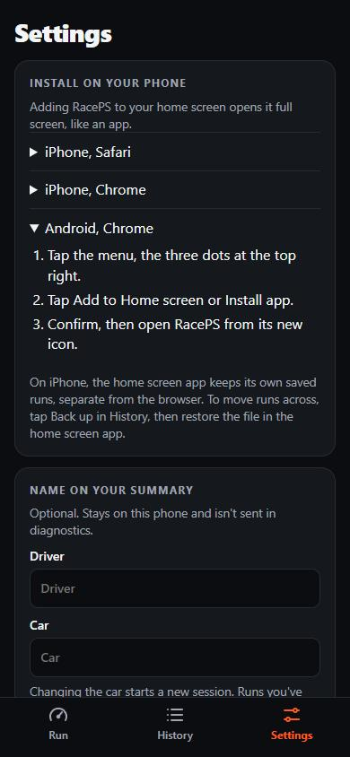

# RacePS

A phone web app for timing car performance runs, such as 0-100 km/h, rolling 60-100 and 100-200, quarter mile and 400/800 m. It installs to the home screen and works offline.

  
  
  

Session screen shows sample data.

## Design

The app is used in one place: a phone on a mount, in a car, often at night. The design follows from that.

- **Read at a glance.** One huge speed readout and one orange action per screen, on a dark base that won't glare at night. Callouts are spoken, so the driver never reads mid-run.
- **Honest numbers.** Sessions show the median of counted runs, not the single best. Each run is graded Good or Fair with the reason given, and any run can be excluded. GPS-only timing is labelled as an estimate.
- **Guidance where it's needed.** The Run screen tells you how to mount the phone and when a run is valid. Settings walks through installing on iPhone and Android, step by step.
- **Accessible.** Every text colour meets WCAG AA contrast (4.5:1 or more), and control outlines meet the 3:1 non-text minimum. Full-screen overlays take focus when they open, keep the screen behind them out of reach, close with Escape, and return focus to where you were. Speed and splits are spoken, so a run never depends on reading the screen.
- **States designed first.** Each screen state was mocked up before it was built: Ready, Running, Result, Session, History and Settings. The mock-ups are in [`mockups/project`](mockups/project). They open in the design-canvas tool they were made in, and show template placeholders in a plain browser.

## How it works

- Uses the phone's GPS and motion sensors, or a Dragy FD02 over Web Bluetooth. `dragy-core.js` decodes Dragy's NAV-PVT-like frame stream: handshake, checksum, fix quality and satellite count.
- Voice callouts for splits, run history and CSV export of raw sensor data.
- Opt-in diagnostics are sent as Netlify Forms submissions. GPS position is deliberately excluded.
- Core logic is plain JavaScript with unit tests (`*.test.js`).

Built in 2026, working with AI coding agents.
